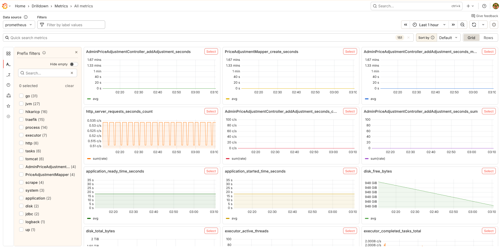

# 🛫 Getting started

## Environment setup
1. Install [Amazon Corretto JDK 21.0.9.11.1](https://github.com/corretto/corretto-21/releases/tag/21.0.9.11.1)
2. Install [Docker](https://docs.docker.com/get-started/introduction/get-docker-desktop/)
   * [docker-compose](https://docs.docker.com/compose/install/)
   * [docker swarm](https://docs.docker.com/engine/swarm/swarm-tutorial/)
3. [Maven 3.9.3](https://maven.apache.org/docs/3.9.3/release-notes.html)

If you have several versions of java on your computer, we recommend using [jEnv](https://www.jenv.be/) for convenient
management among projects.

## Project setup
1. Set *JAVA_HOME* variable with *Amazon Corretto JDK 21.0.9.11.1* in the project root.
2. Build project -> `mvn clean install` (By default integration tests skipped from build part)
3. Build docker image:
```shell
docker build -t price-workflow:latest .   
```
4. Run project with all dependencies:
    1. Go to **docker/app folder**
    2. Run **docker-compose.yml** 
```shell
docker-compose up -d
```

### Setup Mock data
1. Connect to Postgres `localhost:5435` login and password: `postgres`
2. Execute script from `./scripts/mock_data.sql` it will create 100K products with 1-3 price adjustments for 5-10% of products

## Services inside docker-compose
docker-compose contains following services:
* [Traefick](https://github.com/traefik/traefik) available by following address [http://localhost:8080](http://localhost:8080) or [http://traefik.localhost](http://traefik.localhost)
* Price-Workflow available by following address [http://price-workflow.localhost](http://price-workflow.localhost)
* [Postgres](https://www.postgresql.org/docs/17/release-17.html) connection address `jdbc:postgresql://localhost:5435/postgres`
* [Prometheus](https://prometheus.io/) available by following address [http://localhost:9090](http://localhost:9090)
* [Grafana](https://grafana.com/) available by following address [http://localhost:3000](http://localhost:3000)
* [Redis](https://redis.io/downloads/) connection address `jdbc:redis://localhost:6379/0`

### Grafana configuration (while it has not autoconfiguration)
1. Got to `http://localhost:3000`
2. Create new admin user f.e with username and password: admin
3. Go to connection / datasource `http://localhost:3000/connections/datasources`
4. Click Add new data source 
5. Find Prometheus and click to it
6. In **Connection** section enter `http://prometheus:9090`
7. Click **save & test**
8. To see available metrics go to **Home > Drilldown > Metrics > All metrics** `http://localhost:3000/a/grafana-metricsdrilldown-app/drilldown?layout=grid&filters-rule=&filters-prefix=&filters-suffix=&from=now-1h&to=now&timezone=browser&var-ds=bf5tm1obp1q80f&var-metrics_filters=&var-filters=&var-labelsWingman=&search_txt=&var-metrics-reducer-sort-by=default&filters-recent=&var-other_metric_filters=`

#### Sample

