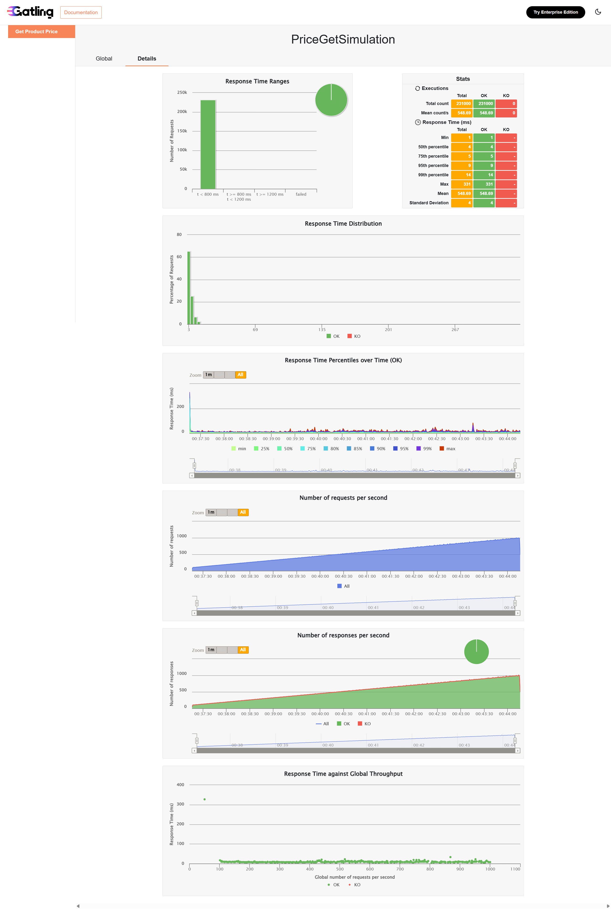
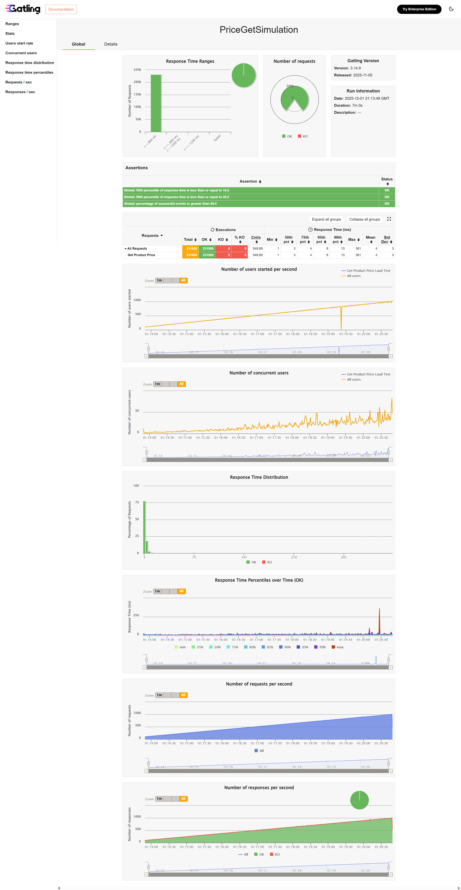
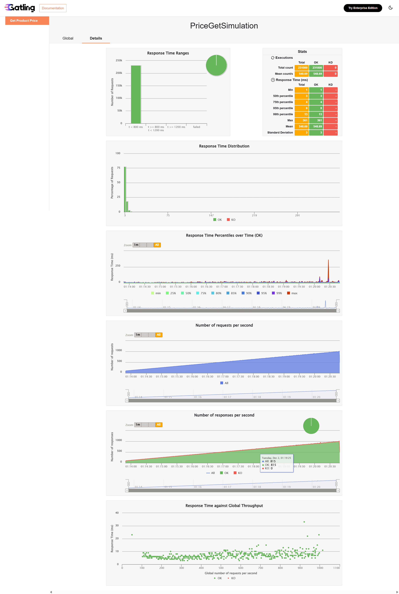
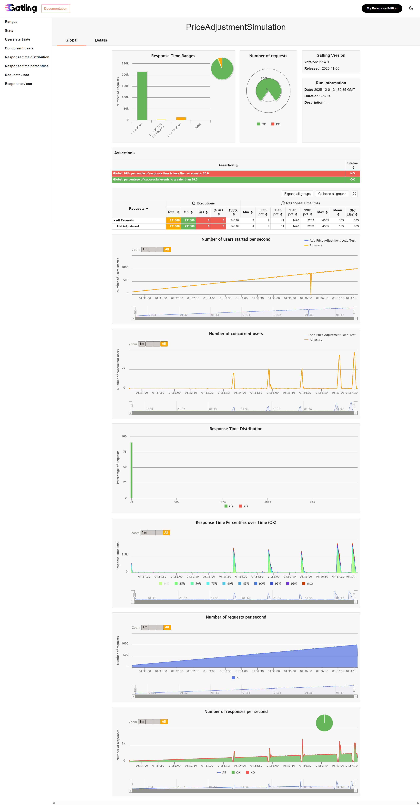
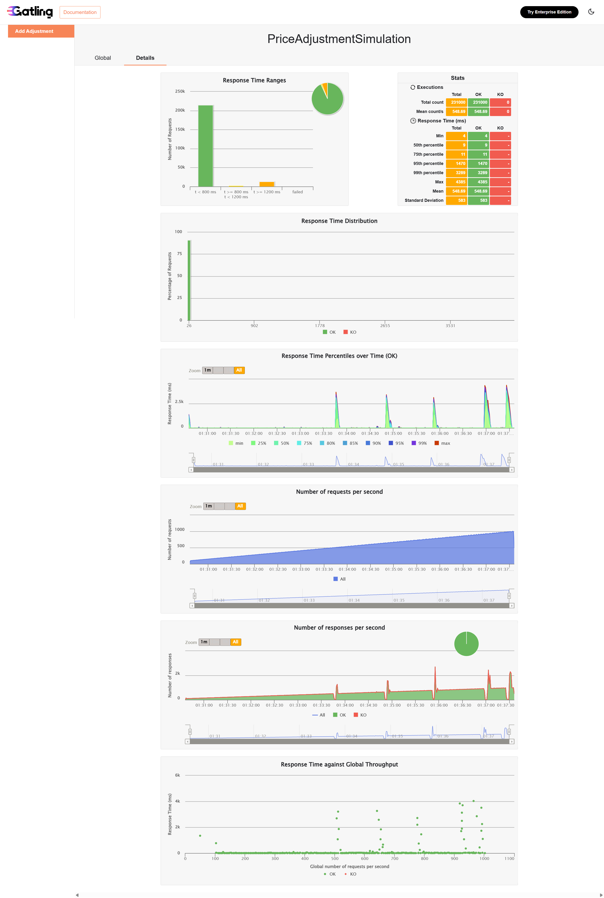
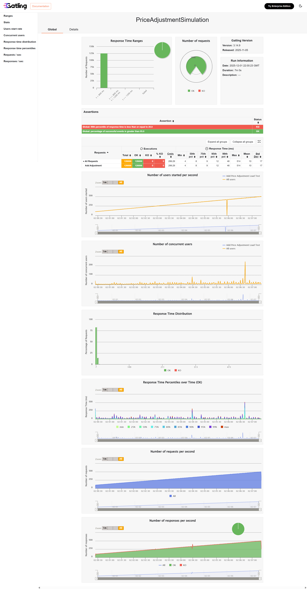
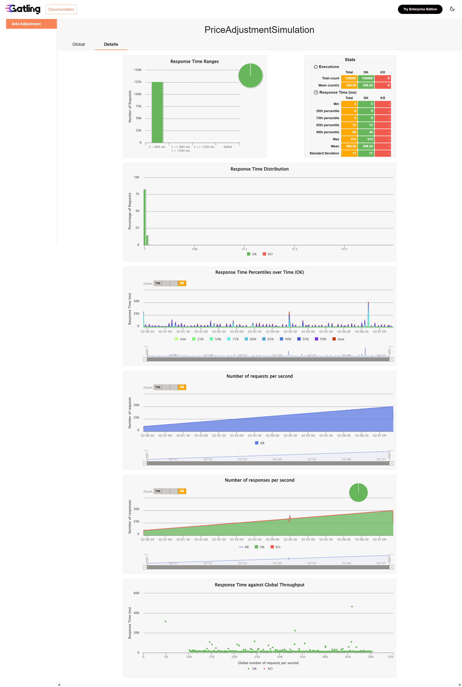

# Test environment

| Parameter name   | Parameter value                                                                                                                                                                                    |
|------------------|----------------------------------------------------------------------------------------------------------------------------------------------------------------------------------------------------|
| OS               | Windows 11 Pro                                                                                                                                                                                     |
| Processor        | 13th Gen Intel(R) Core(TM) i7-13700H / 14 Cores / 20 Logical Processors                                                                                                                            |
| RAM              | 16Gb                                                                                                                                                                                               |
| Hard drive       | SAMSUNG MZVL21T0HCLR-00BL2 (1TB) / Maximum interface speed: 7876 MB/s (PCIe 4.0 x4) / Maximum buffered read speed: 3071 MB/s  / Maximum read speed: 2713 MB/s /Minimum average access time: 0.2 ms |
| Containerization | Windows Docker Desktop                                                                                                                                                                             |
| Spring profile   | PROD                                                                                                                                                                                               |
| Database data    | 100K Products, 1 - 3 Price Adjustments for 5-10 % of products                                                                                                                                      |

## GET Final price + with unwarmed caches

### Gatling run configration

| Parameter Name                 | Value |
|--------------------------------|-------|
| totalDesiredUserCount          | 1_000 |
| userRampUpPerInterval          | 50    |
| rampUpIntervalSeconds          | 30    |
| totalRampUptimeSeconds         | 120   |
| steadyStateDurationSeconds     | 300   |
| Calculated rampUsersPerSec     | 100   |
| Total duration (ramp + steady) | 420 s |

### Report

## GET Final price + with partially warmed up caches
### Gatling run configration

| Parameter Name                 | Value |
|--------------------------------|-------|
| totalDesiredUserCount          | 1_000 |
| userRampUpPerInterval          | 50    |
| rampUpIntervalSeconds          | 30    |
| totalRampUptimeSeconds         | 120   |
| steadyStateDurationSeconds     | 300   |
| Calculated rampUsersPerSec     | 100   |
| Total duration (ramp + steady) | 420 s |

### Report

## POST Save Price Adjustments with partially warmed up caches
### Gatling run configration

| Parameter Name                 | Value |
|--------------------------------|-------|
| totalDesiredUserCount          | 1_000 |
| userRampUpPerInterval          | 50    |
| rampUpIntervalSeconds          | 30    |
| totalRampUptimeSeconds         | 120   |
| steadyStateDurationSeconds     | 300   |
| Calculated rampUsersPerSec     | 100   |
| Total duration (ramp + steady) | 420 s |

### Report

## POST Save Price Adjustments + with unwarmed caches

### Gatling run configration

| Parameter Name                 | Value |
|--------------------------------|-------|
| totalDesiredUserCount          | 500   |
| userRampUpPerInterval          | 50    |
| rampUpIntervalSeconds          | 30    |
| totalRampUptimeSeconds         | 120   |
| steadyStateDurationSeconds     | 300   |
| Calculated rampUsersPerSec     | 100   |
| Total duration (ramp + steady) | 420 s |

### Report

