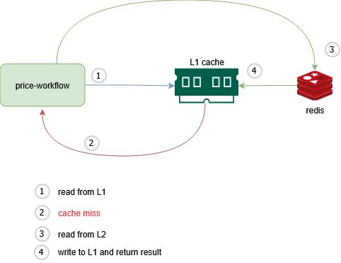
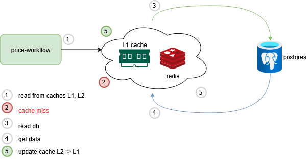

# Project Architecture
## Write data flow (Write through* strategy)


## Get data flow
### Read from Caches(L1, L2) + L1 data missed 


### Read from Caches(L1, L2) and DB if data missed


## Infrastructure
### Redis 


The **price-workflow** service connects to Redis through a Redis Sentinel cluster, ensuring high availability and automatic failover.
 
#### Sentinel-Based Discovery

The application does not connect directly to Redis master/slaves.
Instead, it communicates with Sentinel nodes, which:

* Monitor the Redis master.
* Detect failures.
* Elect a new master if the current master goes down.
* Notify clients (including price-workflow) about topology changes.

#### Failover Handling
If the master becomes unavailable:

1. Sentinel performs a failover, promoting one slave to master.
2. Sentinel notifies the application.
3. price-workflow automatically reconnects to the new master without restart.

### Monitoring


```
                           ┌──────────────────────────────┐
                           │            Clients           │
                           └──────────────┬───────────────┘
                                          │  HTTP :80
                                          ▼
                         ┌──────────────────────────────────────┐
                         │              Traefik                 │
                         │  - Reverse proxy                     │
                         │  - Router for price-workflow         │
                         │  - Dashboard :8080                   │
                         │  - Metrics (Prometheus) :8082        │
                         └───────────────┬──────────────────────┘
                                         │
       ┌─────────────────────────────────┼──────────────────────────────────┐
       │                                 │                                  │
       ▼                                 ▼                                  ▼

┌────────────────┐        ┌────────────────────────────────────┐      ┌────────────────┐
│  Grafana       │        │          Prometheus                │      │  Socket Proxy  │
│  UI :3000      │ <────> │   Scrapes metrics from Traefik     │      │ Controls access│
│                │        │   and price-workflow replicas      │      │ to docker.sock │
└────────────────┘        └────────────────────────────────────┘      └────────────────┘
```

###  Application Layer
```
                         ┌───────────────────────────────────┐
                         │     price-workflow (Replica 1)    │
                         ├───────────────────────────────────┤
                         │     price-workflow (Replica 2)    │
                         └───────────────────────────────────┘
                                   ▲          ▲
                                   │          │
                                   │          │
                                   │          │
                                   └─────┬────┘
                                         │
                                   Load Balancing
                                         │
                                         ▼
                                  Handled by Traefik
```
